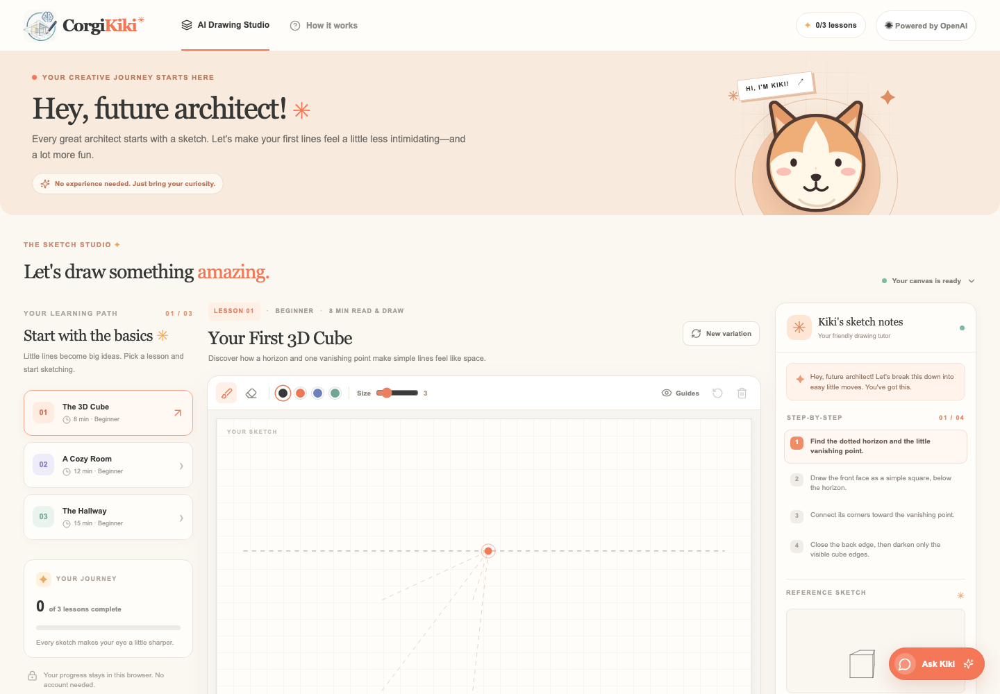
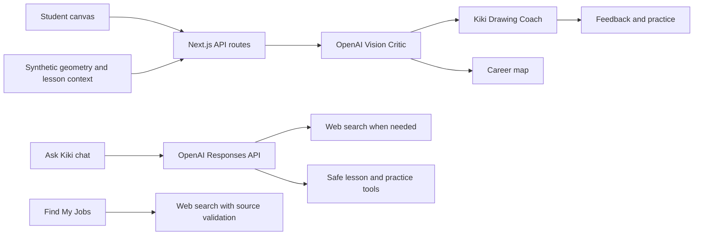

<div align="center">
  <a href="./app/icon.svg"></a>
  <br />
  
  <br />
  <strong>Sketch with confidence. Learn with feedback. Explore where your skills could take you.</strong>
  <br /><br />
  <a href="#try-the-demo">Try the demo</a> · <a href="#what-kiki-can-do">Features</a> · <a href="#how-it-works">Architecture</a> · <a href="./presentation/CorgiKiki_Hackathon_Pitch.pdf">Pitch deck</a>
</div>

---

CorgiKiki is a beginner-friendly architecture drawing studio. Pick a lesson, sketch directly in the browser, and get feedback from an **Architectural Vision Critic** and **Kiki Drawing Coach**. Ask Kiki questions, explore source-linked learning resources, and see a career map based on your latest sketch review.

<div align="center"></div>

## Try the demo

1. Choose **The 3D Cube** and click **Load Sample Drawing**.
2. Click **Ask Kiki to Review My Sketch**. The Vision Critic assesses the image, then Kiki turns that critique into practice steps.
3. Close the feedback to explore **My Architecture Career** and launch a recommended lesson.
4. Open **Ask Kiki** to ask about perspective, analyze your current canvas, or find tutorials with source links.

The AI features require an OpenAI API key. The drawing studio and generated exercises remain usable without one.

## What Kiki can do

| Experience | What is implemented |
| --- | --- |
| **Drawing studio** | Cube, room, and hallway lessons; perspective guides; pen, eraser, undo, clear, sample sketch, and PNG export. |
| **Two-agent sketch review** | A vision call critiques the canvas, followed by a coaching call that creates corrections and personalized practice. |
| **Ask Kiki** | Session conversation history, exercise and critique context, canvas image analysis, optional web search with clickable sources, and bounded lesson/practice actions. |
| **Career explorer** | Approximate skill indicators, career path suggestions, a learning roadmap, and source-linked opportunity search. |

Scores and career readiness are **educational estimates from a sketch**, not grades or hiring predictions. Job links come from web search; check each posting for current availability, location, requirements, and eligibility.

## How it works



The app uses **Next.js 16, React 19, TypeScript, the official OpenAI SDK, and the Responses API**. Review, chat, and job search requests run through server-side routes. Lesson geometry is generated locally, and drawing progress stays in the browser. There is no database or authentication.

## Run locally

```bash
git clone https://github.com/ngstephen1/corgikiki.git
cd corgikiki
npm install
```

Create a root `.env` file with your own key:

```dotenv
OPEN_API_API=your_openai_api_key
```

Then start the app and open it on your Mac:

```bash
npm run dev
open http://localhost:3000
```

The key is read on the server through `process.env.OPEN_API_API`; `.env` is gitignored. An existing local configuration using `OPEN_AI_API` is also supported for compatibility. Never put the key in client code or commit it.

## Checks

```bash
npx tsc --noEmit
npm run build
```

## Presentation

The [five-slide PowerPoint](./presentation/CorgiKiki_Hackathon_Pitch.pptx) and [PDF](./presentation/CorgiKiki_Hackathon_Pitch.pdf) are in `presentation/`.

---

<div align="center"><strong>Every great architect starts with a sketch.</strong> 🐶</div>
